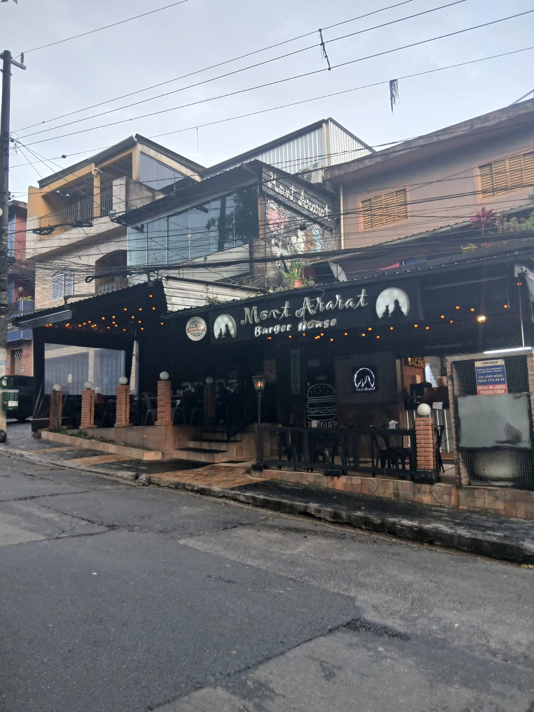

## Entrega 1

### Integrantes do grupo

| Integrante | RGM |
| --- | --- |
| Anna Luiza Ferreira Costa | 48186198 |
| Bruno da Silva Nascimento | 48078883 |
| Kauan Ferreira da Silva Luiz | 47728035 |
| Robert Aparecido Bezerra de Freitas | 47121351 |
| Yasmin Gonçalves Pucci Salem | 48259357 |

### Introdução

A empresa escolhida pelo nosso grupo foi a Mont Ararat, uma hamburgueria localizada na zona leste de São Paulo. O objetivo do nosso projeto foi desenvolver a interface de um site onde os clientes possam futuramente consultar o cardápio, fazer pedidos e ter uma navegação simples e agradável.

### Visita

A visita foi feita presencialmente pelo Kauan, que explicou sobre o projeto e coletou os dados essenciais para o desenvolvimento, como cardápio, preços e fotos.

### Processo de construção

Para montar o site, começamos organizando as fotos reais dos produtos do cardápio e criando um carrossel na página inicial. A partir disso, fomos ajustando o visual e a estrutura das informações, organizando tudo em HTML ao longo de quatro módulos integrados:

- **Início:** página principal do site, com uma breve apresentação dos lanches.
- **Sobre:** um pouco da história da hamburgueria, informações da empresa e a localização das lojas físicas.
- **Carrinho:** interface do resumo da compra, com a exibição dos itens e valores.
- **Contato:** canais diretos de atendimento, como telefone e WhatsApp.

### Uso de IA

O uso de Inteligência Artificial no projeto foi bem pontual. Utilizamos o Google Gemini principalmente para tirar dúvidas de sintaxe em HTML, ajustar a indentação do código e ajudar no alinhamento da estrutura visual e da organização das páginas.

### Dificuldades

As principais dificuldades do grupo foram o fluxo de trabalho com o Git e o GitHub e, especialmente, a conexão correta dos links entre as páginas HTML, o que levou um tempo até conseguirmos ajustar tudo perfeitamente.

### Validação

Todos os arquivos do nosso site foram validados no W3C Validator (https://validator.w3.org/nu/).

### Imagens e licença

A empresa apoiou nossa ideia e concordou com o projeto do site. Como o Kauan é funcionário de lá, ele conversou com a gerente, que autorizou o registro do estabelecimento. Abaixo, estão as fotos como prova da nossa visita e para compor a documentação do projeto:

  

<em>Esse é o Mont Ararat, a empresa que escolhemos para desenvolver nosso projeto.</em>

  

<em>Foto tirada pelo Kauan no momento da visita.</em>

### Conclusão

Esse é o panorama do nosso desenvolvimento até aqui. Mesmo que ainda existam etapas importantes pela frente, como o refinamento do visual e a implementação do banco de dados, o projeto já possui uma base sólida e continua evoluindo constantemente.

---

## Entrega 2

Na segunda etapa do projeto, corrigimos os pontos apontados na devolutiva do professor, aplicamos o CSS e refinamos a estrutura das páginas e do site como um todo. Esta entrega marca a evolução do projeto: saímos de uma base apenas estrutural para um site com identidade visual definida, navegação organizada e elementos funcionais em JavaScript.

### Objetivos da etapa

- Corrigir os erros e os pontos de melhoria comentados na devolutiva do professor.
- Aplicar o CSS em todas as páginas, dando identidade visual ao site.
- Refinar a estrutura do HTML das páginas e do site como um todo.
- Ampliar o site com novas páginas em relação à primeira entrega.
- Validar as páginas no W3C.

### Processo de construção

A segunda etapa trouxe novas páginas em comparação à primeira entrega. O resumo completo delas ficou assim:

- **Index:** página inicial do site, que reúne as principais informações da hamburgueria e o cardápio. No index, o cardápio é apresentado em um carrossel com cards de cada categoria (Burguer, Cheddar, Costela, Frango, Linguiça, Salmão, Vegetariano e Porções), e cada card leva à página correspondente.
- **Cardápio:** lanches, combos e sobremesas do Ararat.
- **Sobre Nós:** a história da hamburgueria e a equipe atual.
- **Contato:** formulário de contato para dúvidas, com campo de texto para a mensagem do cliente.
- **Pagamento:** comprovante de pagamento dos pedidos, com os itens comprados, as quantidades, os valores, o total pago e a estimativa de entrega.
- **Avaliações:** avaliações dos clientes sobre os pedidos.
- **Carrinho:** carrinho de pedidos, com os itens escolhidos pelos clientes, controle de quantidade e botões para continuar comprando ou seguir para o pagamento.
- **Mais Vendidos:** como o nome indica, apresenta os lanches mais vendidos da semana.
- **Locais:** as localizações onde a hamburgueria está situada.
- **Ajuda:** página de ajuda, com perguntas frequentes e um botão que leva à página de contato.

#### Estilização com CSS

O CSS foi aplicado em todo o site, com foco em manter a mesma aparência entre as páginas:

- **Paleta de cores:** definida por variáveis CSS, com tons quentes e escuros (preto carvão, marrom carvão, amarelo mostarda, amarelo claro, creme e terracota), o que facilita ajustes e mantém a consistência visual.
- **Tipografia:** uso da fonte Oswald em todo o site.
- **Botões:** estilos principal e secundário, com efeitos ao passar o mouse, ao clicar e ao receber foco pelo teclado, além do estado desabilitado.
- **Menu de navegação:** estruturado com os componentes de navegação do Bootstrap e personalizado com o CSS do projeto.
- **Carrinho:** cards dos produtos estilizados e controle de quantidade com botões de mais e menos.
- **Responsividade:** ajustes específicos para telas menores, como o empilhamento dos botões do carrinho e a adaptação dos controles de quantidade.

#### Estrutura e semântica do HTML

O HTML foi reorganizado com elementos semânticos, como cabeçalho, navegação, conteúdo principal, seções e rodapé, além de tabelas com legenda e cabeçalhos identificados. O objetivo foi deixar o código mais limpo, legível e dentro das regras de validação do W3C.

### Uso de IA

O uso de inteligência artificial na segunda etapa continuou voltado à semântica e às regras minuciosas de HTML, CSS e JavaScript. Utilizamos como agentes de IA o Claude, o ChatGPT e o Gemini, todos voltados à estruturação e ao funcionamento das páginas.

 

### Validação no W3C

Abaixo está o registro da validação de cada página no W3C, com o caminho do print correspondente.

| Página | Validado | Print |
| --- | --- | --- |
| `index.html` | Sim | [Ver Print](assets/validacoes/index_v.png) |
| `pages/ajuda.html` | Sim | [Ver Print](assets/validacoes/ajuda_v.png) |
| `pages/avaliacoes.html` | Sim | [Ver Print](assets/validacoes/avaliacoes_v.png) |
| `pages/burguer.html` | Sim | [Ver Print](assets/validacoes/burguer_v.png) |
| `pages/cardapio.html` | Sim | [Ver Print](assets/validacoes/cardapio_v.png) |
| `pages/carrinho.html` | Sim | [Ver Print](assets/validacoes/carrinho_v.png) |
| `pages/cheddar.html` | Sim | [Ver Print](assets/validacoes/cheddar_v.png) |
| `pages/compro.html` | Sim | [Ver Print](assets/validacoes/compro_v.png) |
| `pages/contato.html` | Sim | [Ver Print](assets/validacoes/contato_v.png) |
| `pages/costela.html` | Sim | [Ver Print](assets/validacoes/costela_v.png) |
| `pages/doces.html` | Sim | [Ver Print](assets/validacoes/doces_v.png) |
| `pages/frango.html` | Sim | [Ver Print](assets/validacoes/frango_v.png) |
| `pages/linguica.html` | Sim | [Ver Print](assets/validacoes/linguiça.png) |
| `pages/locais.html` | Sim | [Ver Print](assets/validacoes/locais_v.png) |
| `pages/maisvendidos.html` | Sim | [Ver Print](assets/validacoes/mv_v.png) |
| `pages/milkshakes.html` | Sim | [Ver Print](assets/validacoes/milkshake_v.png) |
| `pages/paga.html` | Sim | [Ver Print](assets/validacoes/paga_v.png) |
| `pages/porcoes.html` | Sim | [Ver Print](assets/validacoes/porcoes_v.png) |
| `pages/salmao.html` | Sim | [Ver Print](assets/validacoes/salmao_v.png) |
| `pages/sobrenos.html` | Sim | [Ver Print](assets/validacoes/sobre_v.png) |
| `pages/vegetariano.html` | Sim | [Ver Print](assets/validacoes/vegetariano_v.png) |

 

### Dificuldades encontradas

As maiores dificuldades da equipe foram o CSS e o JavaScript, que envolvem semânticas complexas. A centralização de legendas e imagens também exigiu bastante esforço do grupo.

A validação no W3C foi outro desafio: o validador aponta erros extremamente minuciosos, como um valor numérico escrito sem unidade de medida no CSS, o que dificulta a aprovação das páginas. Foi preciso revisar o código com atenção, linha por linha, para corrigir esses detalhes sem alterar a aparência do site.

### Conclusão final

Ao fim da entrega 2, o projeto ficou com uma interface muito mais harmônica e estruturada, com elementos funcionais em JavaScript, estilização em CSS e um HTML mais limpo e bem organizado. A evolução em comparação com a entrega 1 é notável, tanto no visual quanto na organização do código e na quantidade de páginas e funcionalidades do site.

### Site final
https://astonishing-bavarois-e462b0.netlify.app/
---
